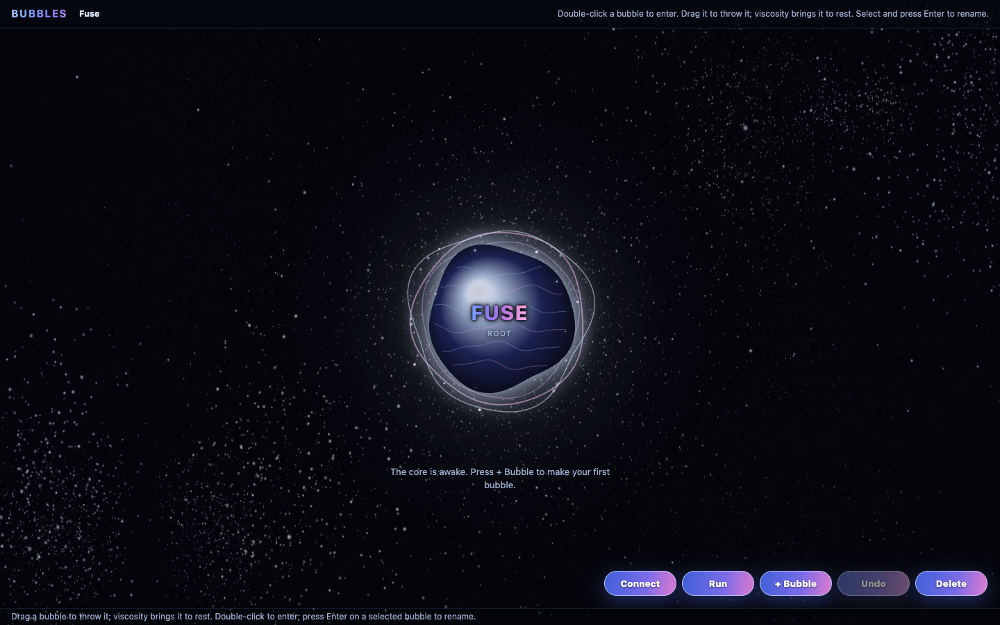

# Bubbles at the ACRYL Bootcamp

Bubbles by **Anthony M. Pesendorfer**: a local canvas where every bubble is a note or a shell command, and Run walks them in the order you drew.

- GitHub: <https://github.com/an7k1ng>
- ACRYL Bootcamp, Vienna, 20 November 2026: <https://github.com/acrylworkshop/bootcamp-2026-11-20>

This repository is a mirror of <https://github.com/an7k1ng/bubbles>. The screenshot was taken from the app at the bootcamp.
